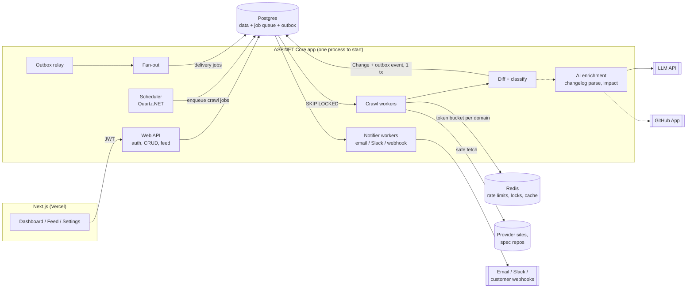

# API Change Radar — Product & Build Plan

> **Know before your integration breaks.**
> API Change Radar watches the third-party APIs a team depends on, detects every change, classifies it as **breaking / deprecation / new**, works out **which of the team's endpoints (and lines of code) are affected**, and alerts them by email, Slack or signed webhook.

**Owner:** Chandrakant Kumar · **Status:** Pre-build, design done · **Last updated:** 26 Oct 2026

The project has two goals, in this order:

1. **Learning.** It is a vehicle for production-grade backend skills: distributed jobs, idempotency, multi-tenancy, webhooks, SSRF and security, observability.
2. **Product.** It should be a real, deployable SaaS that could earn money if it gets traction.

When the two pull in different directions, choose the option that teaches the fundamental idea first (for example, a Postgres queue before RabbitMQ, and our own auth before hosted auth), then switch to the convenient option.

---

## Table of contents

1. [Problem & users](#1-problem--users)
2. [Product scope](#2-product-scope)
3. [How the system works (architecture)](#3-how-the-system-works-architecture)
4. [Data model](#4-data-model)
5. [Core pipelines in detail](#5-core-pipelines-in-detail)
6. [Security](#6-security)
7. [AI features](#7-ai-features)
8. [Tech stack](#8-tech-stack)
9. [Repository layout](#9-repository-layout)
10. [Roadmap & milestones](#10-roadmap--milestones)
11. [Learning map](#11-learning-map)
12. [Design review & proposed additions](#12-design-review--proposed-additions)
13. [Resources](#13-resources)
14. [Open questions to discuss](#14-open-questions-to-discuss)

---

## 1. Problem & users

**Problem.** Dev teams depend on dozens of third-party APIs, such as Stripe, Twilio, GitHub and Shopify. These providers announce breaking changes and deprecations in changelogs, emails, docs pages and spec repos. Each source has its own format, cadence and place, so teams often find out only when production breaks.

**Who feels it**

| Persona | Pain | What they want from us |
|---|---|---|
| Backend / platform engineer (primary) | Gets paged when a vendor removes a field | "Tell me early, tell me only what affects my code, tell me the fix" |
| Engineering manager / tech lead | Can't plan migration work; surprises blow up sprints | A deadline view: what must be migrated, by when |
| On-call / SRE | Noise from generic changelog subscriptions | Severity-filtered alerts into existing channels (Slack, PagerDuty via webhook) |

**Why now / why us.** Many large providers now publish machine-readable OpenAPI specs in public GitHub repos (for example, Stripe, GitHub and Twilio). That makes semantic diffing feasible. LLMs make it feasible to read unstructured changelog prose. The two sources together give better signal than either alone.

**Value proposition (in order of value):**
1. **One feed** of the changes in every API you use.
2. **Correct severity**, so a removed field shows as breaking and a new optional field doesn't.
3. **Relevance**, so you're told only about the endpoints you call.
4. **Impact**, which shows where in your repo the change lands and what the fix is.

---

## 2. Product scope

### MVP (what must exist for a first real user)

- Sign up / sign in (email + password, GitHub OAuth), email verification
- Curated **catalog** of ~10 APIs with known, reliable sources
- Watch an API, optionally filtered to specific endpoints
- Scheduled crawling of each source → snapshot → diff → classified **Change** records
- **Change feed** with filters (All / Affects me / Breaking / Deprecations / New) and a **change detail** page
- Alerts: **email** (immediate + daily digest) and **signed webhook**
- Free plan limit: 3 watched APIs

### V1 (paid tier becomes real)

- Slack alerts, per-channel severity filters
- Endpoint-level filters with autocomplete from the spec
- Upcoming-deadlines panel, snooze / resolve
- Webhook delivery log, retries, secret rotation, "send test event"
- Billing: trial, plans, checkout, plan limits
- AI changelog parsing (prose → structured changes)

### V2 (differentiation)

- GitHub App (read-only) → **AI impact analysis**: files, lines, suggested diff
- Teams: shared workspace, roles, audit log
- **Custom sources**: user-supplied changelog / RSS / OpenAPI URL. This is where SSRF becomes a real threat; see §6.
- GraphQL schema diffing (Shopify, GitHub GraphQL)

### Explicitly out of scope (for now)

Monitoring live API *behaviour* (uptime, latency), SDK version tracking, private/internal APIs, auto-opening PRs.

### Catalog: start with sources that are easy to get

| API | Machine-readable source | Human source |
|---|---|---|
| Stripe | `github.com/stripe/openapi` (OpenAPI) | stripe.com changelog |
| GitHub REST | `github.com/github/rest-api-description` | GitHub changelog / blog |
| Twilio | `github.com/twilio/twilio-oai` | Twilio changelog |
| Others (Slack, SendGrid/Resend, Shopify, OpenAI, Anthropic, Google Maps…) | Check per provider; many have spec repos or RSS | Changelog page / RSS |

Pulling specs from GitHub repos is a good starting point. Fetches are cheap and conditional, history is versioned, and you can backfill by replaying old commits. That gives you **test data for the differ for free**.

---

## 3. How the system works (architecture)

### Design principle: crawl once, fan out many

A **Source** (for example, "Stripe OpenAPI spec") is **global, not per-tenant**. If 500 teams watch Stripe, we fetch Stripe once and compute the diff once. We then fan the resulting Change out to 500 subscriptions. Crawling cost scales with the number of *sources*, and only notification cost scales with *users*. This is the most important architectural decision in the project.

### Shape: a modular monolith first

One deployable .NET app contains the API plus the background workers, which matches the free-tier hosting constraint. It is split into clear modules that could later be pulled out into separate processes:



### Request flow vs. pipeline flow

- **Request path:** short and synchronous. The user clicks, the API reads Postgres and responds, ideally under 100 ms.
- **Pipeline path:** asynchronous, at-least-once and idempotent. It runs **scheduler → crawl job → snapshot → diff → Change + outbox → fan-out → delivery jobs → send**. Every arrow is a durable row in Postgres, so a crash at any point loses nothing; the job is retried.

---

## 4. Data model

The model is Postgres, with every tenant-owned table carrying `org_id`. Global tables (catalog, sources, snapshots, changes) have no `org_id` because they are shared.

```
── Identity & tenancy ───────────────────────────────────────────
users(id, email, email_verified_at, password_hash, created_at)
refresh_tokens(id, user_id, family_id, token_hash, expires_at, revoked_at, replaced_by)
organizations(id, name, plan, trial_ends_at)
memberships(org_id, user_id, role)                    -- owner/admin/member

── Global catalog (shared by all tenants) ───────────────────────
providers(id, slug, name)                              -- "stripe"
sources(id, provider_id, kind, url, poll_interval,     -- kind: openapi|changelog_html|rss|github_releases
        next_check_at, etag, last_modified, last_success_at, consecutive_failures)
snapshots(id, source_id, content_hash, storage_key, fetched_at)   -- normalized content
endpoints(id, provider_id, method, path)               -- extracted from latest spec
changes(id, provider_id, endpoint_id NULL, severity,   -- breaking|deprecation|new|info
        kind, title, summary, details_json, effective_at NULL,
        correlation_key, first_seen_at, sources[])     -- merged from spec + changelog

── Tenant data ─────────────────────────────────────────────────
watches(id, org_id, provider_id, endpoint_filter[] NULL)          -- NULL = all endpoints
alert_channels(id, org_id, type, config_encrypted, min_severity, verified_at)
change_states(org_id, change_id, status, snoozed_until)           -- resolved / snoozed
deliveries(id, org_id, change_id, channel_id, status, attempts,
           next_attempt_at, last_error, UNIQUE(change_id, channel_id))
repo_connections(id, org_id, installation_id, repo_full_name)
impact_analyses(id, org_id, change_id, repo_id, commit_sha, result_json)
audit_log(id, org_id, actor_id, action, target, ip, at)

── Infrastructure ──────────────────────────────────────────────
jobs(id, type, payload, idempotency_key UNIQUE, status, attempts,
     run_after, locked_by, locked_until, last_error)
outbox(id, aggregate, event_type, payload, created_at, processed_at)
dead_letters(id, job_id, type, payload, error, failed_at)
```

The uniqueness constraints are what make the pipeline safe to retry:

- `jobs.idempotency_key` means two schedulers can't enqueue the same crawl for the same window, for example `crawl:{source_id}:{2026-10-26T10:00}`.
- `deliveries UNIQUE(change_id, channel_id)` means fan-out can run twice without double-alerting.
- `snapshots(source_id, content_hash)` means an unchanged page never produces a diff.

---

## 5. Core pipelines in detail

### 5.1 Scheduling

- A Quartz.NET job runs every minute. It selects `sources WHERE next_check_at <= now()` and inserts crawl jobs with an idempotency key, using `ON CONFLICT DO NOTHING`.
- Poll intervals differ by source kind. Spec repos can be polled often (cheap, with ETag), while HTML changelogs should be polled every 1–6 h. Add jitter so sources don't all fire at :00.
- With multiple app instances, the scheduler needs a **distributed lock** (a Redis `SET NX PX` lock or a Postgres advisory lock) so only one instance enqueues. The idempotency key is the second line of defence.

### 5.2 The Postgres job queue (phase 1 of "distributed")

```sql
-- claim one job (each worker loops on this)
UPDATE jobs SET status='running', locked_by=@worker, locked_until=now()+interval '5 min',
                attempts = attempts + 1
WHERE id = (
  SELECT id FROM jobs
  WHERE status IN ('queued','running') AND run_after <= now()
    AND (locked_until IS NULL OR locked_until < now())   -- reclaim crashed workers' jobs
  ORDER BY run_after
  FOR UPDATE SKIP LOCKED
  LIMIT 1)
RETURNING *;
```

- **Lease / visibility timeout.** If a worker dies, `locked_until` expires and another worker picks the job up. That is why every handler must be **idempotent**.
- **Retries** use exponential backoff with full jitter: `run_after = now() + random(0, base * 2^attempt)`.
- **Dead-letter queue.** After N attempts, move the job to `dead_letters` and surface it in an ops screen with a **Replay** button.
- **Transactional outbox.** When the differ writes a `Change`, it writes the `outbox` event **in the same transaction**. A relay reads the outbox and creates fan-out jobs. This avoids the "saved the change but crashed before alerting" bug.
- **Phase 2:** swap the transport to **RabbitMQ** (CloudAMQP free) behind an `IJobQueue` interface. Keep the outbox; it is still how you publish reliably. Learn ack/nack, prefetch, DLX (dead-letter exchanges) and delayed retry via TTL queues.

### 5.3 Fetching (politely and safely)

- **Conditional requests** (`If-None-Match` / `If-Modified-Since`) mean most checks come back as a cheap `304`.
- **Per-domain rate limiting** uses a Redis token bucket keyed by host (for example, 1 request per 10 s per domain). If no token is available, the job is rescheduled rather than blocking a worker.
- **Politeness:** respect `robots.txt` (cached), send an identifying `User-Agent` with a contact URL, and honour `Retry-After` on 429/503.
- Hard limits: connect/read timeouts and a max body size (for example, 10 MB).
- All fetches go through one **`SafeHttpClient`**; see SSRF in §6.
- Use `Microsoft.Extensions.Http.Resilience` (Polly) for transient retries *inside* a job. Job-level retries handle the rest.

### 5.4 Snapshot & normalize

Diff noise mostly comes from what you *don't* normalize:

- **OpenAPI:** parse with `Microsoft.OpenApi`, resolve `$ref`s, and re-serialize canonically with sorted keys and formatting stripped.
- **HTML changelog:** extract the main content (AngleSharp), drop nav, scripts and timestamps, and split it into **entries** (heading + date + body). Diff at entry level, not page level.
- **RSS / GitHub releases:** these are already entry-structured. Key them on GUID or tag.

Hash the normalized content. If the hash is the same as last time, stop.

### 5.5 Diff & classify

**OpenAPI semantic diff** is a rules engine over two parsed documents. Start with a small, well-tested rule set:

| Change | Severity | Why |
|---|---|---|
| Path or operation removed | Breaking | Calls will 404 |
| Response field removed / renamed | Breaking | Clients reading it break |
| Request param becomes required / new required param | Breaking | Existing calls fail validation |
| Field type changed | Breaking | Deserialization breaks |
| Request enum value removed | Breaking | Existing values rejected |
| Response enum value **added** | Potentially breaking | Exhaustive switch statements break |
| `deprecated: true` added | Deprecation | Plus `effective_at` if a sunset date is found |
| New optional param / new response field / new endpoint | New | Additive |

Treat **oasdiff** (open-source, Go) as your **test oracle**. Run it on the same spec pairs and compare outputs. Write your own differ in C# for the learning, and use oasdiff to catch rules you missed.

**Changelog entries.** New entries go to the LLM parser (§7), which returns structured changes.

**Correlation / dedup.** The same change often appears in both the spec and the changelog. Build a `correlation_key` (`provider + endpoint + field + kind`) and merge both observations into one `Change`. The design already shows "Source: Changelog and OpenAPI spec".

### 5.6 Fan-out & notification

1. The outbox event `ChangeDetected(change_id)` triggers a fan-out job.
2. Fan-out finds matching `watches`: same provider, plus endpoint-filter match (or no filter).
3. For each matching org's channels where `severity >= min_severity`, it inserts `deliveries` rows (`ON CONFLICT DO NOTHING`) and enqueues send jobs.
4. Each **send job** handles one delivery (email / Slack / webhook), with its own retry and backoff and a status shown in the UI ("Retrying (attempt 2)").

**Signed outbound webhooks** follow the Standard Webhooks spec, so customers can verify the requests with off-the-shelf libraries:

```
webhook-id: msg_2xK…               ← idempotency key for the receiver
webhook-timestamp: 1798300000      ← receiver rejects if older than 5 min (replay protection)
webhook-signature: v1,base64(HMAC_SHA256(secret, "{id}.{timestamp}.{body}"))
```

- **Secret rotation:** keep old and new secrets valid for 24 h and send both signatures.
- Retry schedule: 1 min, 5 min, 30 min, 2 h, 8 h, 24 h, then DLQ. Auto-disable an endpoint after repeated failures and notify the owner by email.
- Every attempt is logged (status code, latency, truncated response) for the delivery log.

---

## 6. Security

### 6.1 SSRF

Our server fetches URLs: crawl sources (and later, user-supplied ones) and **customer webhook URLs**. Webhook URLs are user-supplied too, so the SSRF threat starts at MVP, not V2. An attacker could set their webhook URL to `http://169.254.169.254/latest/meta-data/` or `http://localhost:5432` to probe internal services.

Defences, all inside `SafeHttpClient`:

1. Allow only `https` (and `http` only for known catalog sources), and only ports 443 (and 80).
2. **Validate the IP at connect time**, not just at parse time. In .NET, use `SocketsHttpHandler.ConnectCallback`: resolve DNS yourself, reject private, loopback, link-local, CGNAT, multicast and metadata ranges (`10/8`, `172.16/12`, `192.168/16`, `127/8`, `169.254/16`, `100.64/10`, `::1`, `fc00::/7`, `fe80::/10`, and IPv4-mapped IPv6), then connect to **that** IP. This defeats **DNS rebinding**, where a domain resolves to a public IP at validation time and a private IP at fetch time.
3. **Disable automatic redirects.** Follow them manually, at most 3 hops, re-validating each hop.
4. Apply timeouts and a response size cap. Don't reflect raw response bodies back to the user.
5. Write tests for each bypass: decimal IPs (`http://2130706433`), `0.0.0.0`, `[::ffff:127.0.0.1]`, redirects to localhost, and rebinding domains. Practise on PortSwigger's SSRF labs first.

### 6.2 Auth

- ASP.NET Core Identity for users and password hashing, with a minimum length of 12 (the design already says this). Email verification goes through Resend.
- **Access JWT** lasts about 15 min and is kept in memory on the client. The **refresh token** is opaque and random, stored **hashed**, and sent as an `httpOnly; Secure; SameSite` cookie.
- **Refresh rotation with reuse detection.** Each refresh issues a new token in the same `family_id`. If a revoked token is presented again, revoke the whole family, because it was stolen.
- GitHub OAuth for "Continue with GitHub", linked to the same user by verified email.
- Rate-limit login, signup and password reset using ASP.NET Core's rate limiter with a Redis-backed store for multiple instances.

### 6.3 Multi-tenancy isolation

- Every tenant table has `org_id`, and EF Core **global query filters** add `WHERE org_id = @current` automatically.
- **Defence in depth:** optionally enable Postgres **Row-Level Security** with the org set via `SET app.org_id`, so one bug in the app can't leak another tenant's data.
- Add an integration test suite that creates two orgs and asserts that org B can never read org A's resources through any endpoint (IDOR tests).

### 6.4 Other

- Encrypt secrets at rest (webhook secrets, Slack URLs, the GitHub App private key) using ASP.NET Data Protection or envelope encryption. Never log them.
- Keep an **audit log** for security-relevant actions: login, secret rotation, channel changes, member changes and plan changes.
- Make the OWASP Top 10 and ASVS level 1 a checklist in the repo, and tick it off per feature.

---

## 7. AI features

### 7.1 Changelog parsing (V1)

- **Input:** one new changelog entry (text) plus the provider's known endpoint list.
- **Output:** strict JSON-schema structured output: `[{severity, kind, endpoint, field, summary, effective_at, confidence}]`.
- Validate the output against the schema and the endpoint list. Low confidence gets the label "Needs review" rather than an alert.
- **Build an eval set early.** Label 50–100 real changelog entries by hand and run them on every prompt change. This is the most transferable AI-engineering skill in the project.
- Control cost: run only on *new* entries (hash-gated), and cache by entry hash.

### 7.2 Impact analysis (V2)

- The user installs a **GitHub App** with read-only `contents` access on chosen repos.
- When a breaking or deprecation change affects an org with a connected repo:
  1. **Find candidates deterministically first.** Use GitHub code search, or a shallow clone plus `ripgrep`, for the path (`/v2/charges`), SDK method names (`charges.create`) and field names (`last4`).
  2. Send only those snippets and the change to the LLM, which returns a list of file and line references with an explanation, plus a suggested patch.
- Cache by `(change_id, repo, commit_sha)`. Always show the "AI suggestions can be wrong" note (already in the design).
- Keep all of this behind an `IImpactAnalyzer` interface so the LLM provider can be swapped.

---

## 8. Tech stack

| Layer | Choice | Notes / adjustments |
|---|---|---|
| Backend | **ASP.NET Core Web API on .NET 10 (LTS)**, EF Core + Npgsql | ⚠️ Use .NET 10, not .NET 9. .NET 9 support ends on **10 Nov 2026**, two weeks from today. .NET 10 is the current LTS. |
| Architecture | Clean Architecture / modular monolith | Domain → Application → Infrastructure → Api. Don't over-engineer CQRS; MediatR is optional. |
| Database | Supabase Postgres (used as plain Postgres) | Free projects pause when inactive. Workers using `SKIP LOCKED` / advisory locks should use the **direct or session-mode** connection, not the transaction-mode pooler. |
| Auth | ASP.NET Identity + JWT + rotating refresh tokens (our own) | Plus GitHub OAuth |
| Frontend | Next.js (React + TS), Tailwind, shadcn/ui, TanStack Query | Deploy on Vercel. Generate the TS API client from the backend's OpenAPI document. |
| Cache / rate limit / locks | Upstash Redis (free) | Token buckets, distributed locks, feed caching |
| Queue | Postgres (`SKIP LOCKED` + outbox) → RabbitMQ (CloudAMQP free) | Hide behind `IJobQueue` |
| Scheduling / workers | `BackgroundService` + Quartz.NET | |
| HTTP resilience | `Microsoft.Extensions.Http.Resilience` (Polly) | |
| Parsing / diff | `Microsoft.OpenApi`, AngleSharp (HTML), DiffPlex (text), oasdiff as test oracle | |
| Email | Resend | Verification, alerts, digests |
| Payments | ⚠️ Stripe accounts are **invite-only in India**. Use a **merchant of record** (Paddle or Lemon Squeezy) or **Razorpay Subscriptions** | Wrap behind `IBillingProvider` so the provider can be swapped. Learn the same concepts either way: checkout, subscription webhooks, idempotent handling, trial state. |
| LLM | Any provider with JSON-schema structured output (e.g. Claude) | Behind an interface, with an eval set in the repo |
| Observability | OpenTelemetry → Grafana Cloud (free) | Traces across API → job → delivery; queue depth and DLQ size metrics |
| Testing | xUnit, **Testcontainers** (real Postgres/Redis/RabbitMQ in tests), k6 for load | |
| CI/CD | GitHub Actions, Docker | Build, test, migrations check, image push, deploy |
| Hosting | Render (API + in-process worker), Vercel (web) | Render free sleeps after ~15 min idle; wake it with cron-job.org or a GitHub Actions ping. A small always-on VM is an alternative once real users arrive. |

---

## 9. Repository layout

```
APIChangeRadar/
├─ src/
│  ├─ Radar.Domain/            # entities, value objects, severity rules (no deps)
│  ├─ Radar.Application/       # use cases, interfaces (IJobQueue, ISafeHttpClient, IBillingProvider…)
│  ├─ Radar.Infrastructure/    # EF Core, Postgres queue, Redis, Resend, Slack, LLM, GitHub
│  ├─ Radar.Diffing/           # OpenAPI differ + changelog normalizer (pure, heavily tested)
│  ├─ Radar.Api/               # controllers/minimal APIs, auth, rate limiting
│  └─ Radar.Worker/            # hosted services: scheduler, crawl, fan-out, deliveries
│                              #   (referenced by Api at first → one process)
├─ web/                        # Next.js app
├─ tests/
│  ├─ Radar.Diffing.Tests/     # golden-file tests: specA.json + specB.json → expected changes
│  ├─ Radar.Integration.Tests/ # Testcontainers; tenancy/IDOR, SSRF, queue semantics
│  └─ load/                    # k6 scripts
├─ eval/                       # labelled changelog entries for the LLM parser
├─ docs/                       # ADRs (architecture decision records), this file
├─ docker-compose.yml          # postgres, redis, rabbitmq, mailpit for local dev
└─ .github/workflows/
```

Write a short **ADR** (architecture decision record) for each big decision: Postgres queue, the outbox, refresh-token design, the SSRF approach and the billing provider. ADRs are good interview material later.

---

## 10. Roadmap & milestones

The timing assumes evenings and weekends, roughly 10–12 h a week, so treat it as a guide. Each phase ends with something **deployed**.

| # | Phase | What you build | Done when… | ~Weeks |
|---|---|---|---|---|
| 0 | **Setup** | Repo, solution structure, docker-compose, CI (build + test), deploy a "hello" API + web | A PR to `main` auto-deploys | 1 |
| 1 | **Foundation** | EF migrations, signup/login, email verification, JWT + refresh rotation, GitHub OAuth, orgs, OWASP checklist | Sign-in screen works end-to-end; refresh reuse revokes the family (test) | 3 |
| 2 | **Core product** | Catalog seed (3 APIs), watches CRUD, single-worker crawler, snapshots, OpenAPI differ with ~10 rules, feed + detail page | Replaying Stripe spec history produces sensible changes in the feed | 4 |
| 3 | **Make it distributed** | Postgres job queue, multiple workers, leases, idempotency keys, backoff, DLQ + replay, per-domain token bucket, distributed scheduler lock, outbox, fan-out, email alerts | Kill a worker mid-job: nothing lost, nothing duplicated (chaos test) | 3–4 |
| 4 | **Harden security** | SafeHttpClient (SSRF), signed webhooks + rotation + delivery log, API rate limiting, secrets encryption, audit log, tenancy tests | All SSRF bypass tests pass; webhook verifies with a Standard Webhooks library | 2–3 |
| 5 | **AI v1** | Changelog fetch + LLM parsing, eval set, correlation/dedup with spec changes | Eval score tracked in CI; changelog-only changes appear correctly | 2 |
| 6 | **Monetize** | Plans, trial logic, limits enforcement, checkout + subscription webhooks (idempotent), Slack channel | A test-mode subscription upgrades the plan; limits enforced server-side | 2–3 |
| 7 | **Production** | OpenTelemetry dashboards, k6 load tests, caching, indexes, partition `deliveries`/`snapshots` by month, move to RabbitMQ | p95 feed < 200 ms at target load; dashboard shows queue depth and DLQ | 3 |
| 8 | **AI v2** | GitHub App, impact analysis, suggested fixes | Detail page shows real file/line impacts for a test repo | 3 |

**Suggested first public launch:** after phase 6. Share it in communities where people complain about breaking API changes, and get 5–10 real users before phase 7.

---

## 11. Learning map

Where each concept you want to learn shows up in the product:

| Concept | Where it lives here | Phase |
|---|---|---|
| Clean architecture, EF Core migrations | Whole backend | 1 |
| Auth: hashing, JWT, refresh rotation, OAuth | Sign-in / sign-up | 1 |
| Scheduled distributed crawling, job queues, workers | Scheduler + crawl workers | 2–3 |
| Idempotency, retries, backoff with jitter, DLQ | Every job; `deliveries` uniqueness | 3 |
| Leases / visibility timeouts, at-least-once delivery | Postgres queue, RabbitMQ acks | 3, 7 |
| Distributed locks | Single-scheduler election | 3 |
| Transactional outbox | Change → alerts | 3 |
| Per-domain rate limiting & politeness | Redis token bucket, robots.txt, 304s | 3 |
| Diffing & change detection | Normalizer + OpenAPI rules engine | 2 |
| Multi-tenancy & fan-out | Global sources → per-org deliveries; query filters / RLS | 3–4 |
| Webhooks + HMAC signing, replay protection, rotation | Outbound webhooks | 4 |
| SSRF (DNS rebinding, redirects, IP ranges) | SafeHttpClient | 4 |
| Payments, subscription webhooks | Billing | 6 |
| Observability (traces, metrics, logs) | OTel across the pipeline | 7 |
| Performance: indexing, partitioning, caching, load tests | Feed, deliveries, snapshots | 7 |
| Applied LLMs: structured output, evals, RAG-lite code search | Changelog parsing, impact analysis | 5, 8 |

---

## 12. Design review & proposed additions

The Figma design is strong. The landing, sign-in, feed, change-detail and settings screens are clear, the severity colours are consistent, and the detail page (diff + impact + per-channel delivery status) is the best screen. It already communicates the product well. Below are the gaps and some suggestions.

### Small fixes to existing screens

- **Pricing placeholders.** Decide pricing after talking to ~10 potential users. Keep the meter as "watched APIs" plus "channels", as the description says.
- **Feed:** add a "Snoozed / Resolved" filter, since the detail page can snooze and resolve but the feed can't show those items. Consider grouping by **deadline** ("Due in < 30 days") as an alternative sort.
- **Change detail:** add a **"Wrong classification?"** feedback button. It feeds the AI eval set directly.
- **Watched APIs list:** show **source health** (last successful check, failing sources). Users trust the feed only if they know the crawler is alive.
- **Webhook settings:** "1 delivery retrying" should link to a **delivery log**.

### Missing screens worth designing

1. **Onboarding (3 steps):** pick APIs → pick endpoints (autocomplete from the spec, or "paste a few URLs from your code") → connect a channel → land on a feed **pre-filled with the last 90 days** of changes so it isn't empty on day one.
2. **API page:** one provider's change history timeline, its sources and their health. This also works as a **public, SEO-indexable page** (for example, "Stripe API changes"), which is a cheap growth channel.
3. **Webhook delivery log:** attempts, status codes, latency, payload, and **Resend**.
4. **Team & members** (Team plan): invite, roles, audit log viewer.
5. **Ops console (internal admin):** queue depth, jobs per state, **DLQ with replay**, per-source crawl health and rate-limit status. This screen makes the distributed-systems work visible and makes debugging much easier.
6. **Empty and error states:** no APIs watched yet, source failing, trial ended.
7. **Email templates:** immediate alert and daily digest.

---

## 13. Resources

**Distributed systems & reliability**
- *Designing Data-Intensive Applications*, Martin Kleppmann. Read the chapters on replication, transactions, and stream processing.
- *Release It!*, Michael Nygard. Covers stability patterns: timeouts, circuit breakers, bulkheads.
- "Exponential Backoff and Jitter", AWS Architecture Blog (Marc Brooker).
- Transactional Outbox pattern, microservices.io (Chris Richardson).
- brandur.org: "Implementing Stripe-like Idempotency Keys in Postgres" and "Transactionally Staged Job Drains in Postgres".
- "What is SELECT … SKIP LOCKED for in PostgreSQL 9.5?", 2ndQuadrant blog (Craig Ringer).
- RabbitMQ official tutorials, especially the sections on reliability, acknowledgements and dead-letter exchanges.

**APIs, specs & diffing**
- OpenAPI Specification 3.1, spec.openapis.org.
- oasdiff on GitHub. Read its breaking-changes rule list.
- Stripe blog: "APIs as infrastructure: future-proofing Stripe with versioning".
- Spec repos: `stripe/openapi`, `github/rest-api-description`, `twilio/twilio-oai`.

**Webhooks**
- Standard Webhooks spec: standardwebhooks.com.
- Stripe docs on verifying webhook signatures, for the receiver-side perspective.

**Security**
- OWASP Top 10 and the OWASP ASVS.
- OWASP **SSRF Prevention Cheat Sheet**.
- PortSwigger Web Security Academy, **SSRF labs**. These are free and hands-on.
- OWASP JWT and Session Management cheat sheets.

**.NET**
- Microsoft Learn: ASP.NET Core Identity, rate limiting middleware, EF Core (global query filters, migrations), `IHttpClientFactory` + resilience, hosted services.
- Quartz.NET docs, Testcontainers for .NET, OpenTelemetry .NET.
- Andrew Lock's and Milan Jovanović's blogs for practical ASP.NET Core patterns.

**Product & frontend**
- Next.js docs (App Router), TanStack Query docs, shadcn/ui.

---

## 14. Open questions to discuss

1. **Catalog vs. custom URLs at MVP.** The catalog-only MVP is safer and faster. Custom sources bring the SSRF lesson forward, but webhooks already force SSRF hardening at MVP. Which do we want first?
2. **Endpoint selection UX.** Will users really tick endpoints by hand? Alternatives are to infer them from the connected repo, or to paste code or URLs.
3. **Spec-first or changelog-first?** Spec diffs are precise but not every API publishes a spec. Changelogs cover everyone but need the LLM.
4. **Billing provider** given Stripe India's invite-only status: Paddle / Lemon Squeezy (merchant of record handles tax) vs. Razorpay.
5. **Pricing** for Pro/Team. What's the anchor? One prevented outage is worth far more than a monthly fee, but the first users will be small teams.
6. **Ops vs. learning trade-off on hosting.** Should we stay on free tiers until the first users arrive, or pay for a small always-on VM from phase 3 so the worker isn't sleeping?
7. **Time budget.** Is ~10–12 h/week realistic? It sets whether launch is in ~4 or ~7 months.
